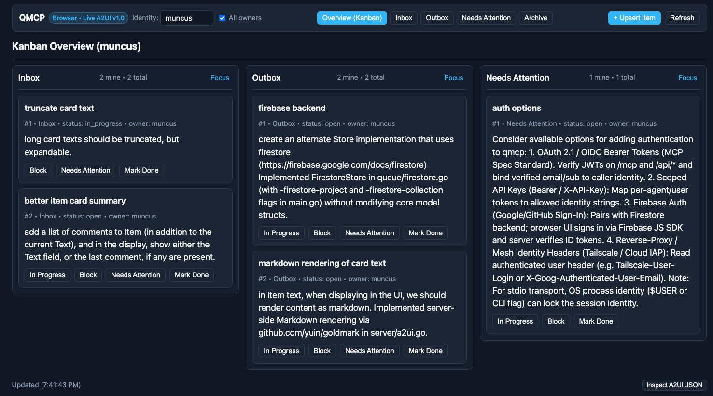

# QMCP — Task Queue MCP Server

**QMCP** is a Model Context Protocol (MCP) server in Go that provides shared, multi-user task queues (`Inbox`, `Outbox`, `Needs Attention`, `Archive`) with interactive **A2UI v1.0** surfaces, an embedded **MCP App** (`ui://qmcp/board`), and a live browser Kanban board.

- **Agent Workflow Guide:** [USAGE.md](USAGE.md)
- **Design Specification:** [docs/design.md](docs/design.md)



## Features

- **4 Standard Queues:** `Inbox`, `Outbox`, `Needs Attention`, and `Archive` (items marked `done` or `cancelled` auto-archive).
- **A2UI v1.0 + MCP Apps (`ui://qmcp/board`):**
  - 3-column Kanban Overview (`Inbox`, `Outbox`, `Needs Attention`) with drag-and-drop between queues and 1-indexed positions.
  - Truncated card previews (showing the latest comment if present, or item `text`) with server-side GitHub Flavored Markdown rendering (`goldmark`).
  - Single-item detail `a2ui.Modal` with full Markdown description, structured `data` inspector, links, and interactive comment thread (`add_comment`).
- **Pluggable Storage Backends:**
  - **JSONL file store** (default, atomic writes + live reload on external file modifications).
  - **Google Cloud Firestore** (`-firestore-project` / `QMCP_FIRESTORE_PROJECT`).

## Quickstart

### Build & Run

```bash
# Build the binary
go build -o qmcp .

# Run over stdio (default, using qmcp.jsonl)
./qmcp

# Run the live browser Kanban UI + Streamable HTTP MCP server on :8082
./qmcp -http :8082 -store-file qmcp.jsonl
```

When `-http :8082` is enabled:
- **Browser Kanban UI:** `http://localhost:8082/`
- **Streamable HTTP MCP Endpoint:** `http://localhost:8082/mcp`
- **Direct Tool JSON API:** `POST http://localhost:8082/api/tool`
- **Live SSE Updates:** `GET http://localhost:8082/api/events`

### CLI Flags & Environment Variables

| Flag | Environment Variable | Default | Description |
| :--- | :--- | :--- | :--- |
| `-store-file` | `QMCP_STORE_FILE` | `qmcp.jsonl` | Path to the JSONL persistence file |
| `-firestore-project` | `QMCP_FIRESTORE_PROJECT` | *(empty)* | Google Cloud project ID to use Firestore backend |
| `-firestore-collection` | `QMCP_FIRESTORE_COLLECTION` | `qmcp_items` | Firestore collection name |
| `-http` | `QMCP_HTTP_ADDR` | *(empty)* | HTTP listen address (e.g. `:8082`) for Web UI and `/mcp` |
| `-stdio` | — | `false` | Also serve MCP over `stdio` when `-http` is set |

## Example MCP Client Configuration

### Option 1: Streamable HTTP (connecting to a running `qmcp -http :8082` server)

 Recommended when sharing a live Kanban board in the browser alongside one or more MCP clients:

```json
{
  "mcpServers": {
    "qmcp": {
      "url": "http://localhost:8082/mcp"
    }
  }
}
```

### Option 2: Stdio Transport (launched directly by the MCP client)

```json
{
  "mcpServers": {
    "qmcp": {
      "command": "/path/to/qmcp",
      "args": [
        "-store-file",
        "/path/to/qmcp.jsonl"
      ]
    }
  }
}
```

### Option 3: Stdio + Embedded Web UI

```json
{
  "mcpServers": {
    "qmcp": {
      "command": "/path/to/qmcp",
      "args": [
        "-stdio",
        "-http",
        ":8082",
        "-store-file",
        "/path/to/qmcp.jsonl"
      ]
    }
  }
}
```
